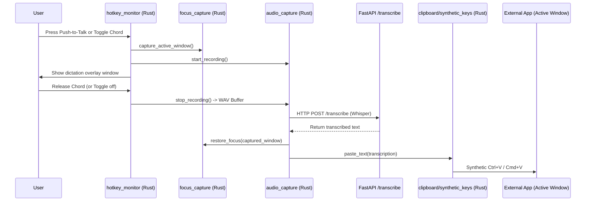

# Tauri Desktop & Audio Skill

## Goal

Provide reference architecture, low-level integration patterns, and best practices for developing, testing, and debugging the Tauri 2 desktop layer in Voicebox.

## Key Files & Modules

- `tauri/src-tauri/src/main.rs` — Tauri application setup, plugins, window initialization, IPC commands, and sidecar launcher
- `tauri/src-tauri/src/hotkey_monitor.rs` — Global keyboard listener using `keytap::chord::ChordMatcher` (PushToTalk & ToggleToTalk)
- `tauri/src-tauri/src/audio_capture/` — Low-level microphone stream capture, WAV buffer accumulation, and sample rate normalization
- `tauri/src-tauri/src/focus_capture.rs` — Capturing and restoring the active external OS window before/after dictation
- `tauri/src-tauri/src/clipboard.rs` & `synthetic_keys.rs` — Clipboard backup, pasting text into the target app, and restoring original clipboard
- `tauri/src-tauri/src/audio_output.rs` — Multi-device playback routing via CPAL
- `backend/server.py` — Sidecar entry point with parent-PID watchdog to auto-kill Python if Tauri crashes

## 1. Global Dictation Architecture & Flow



## 2. Push-to-Talk vs Toggle Semantics (`hotkey_monitor.rs`)

`hotkey_monitor.rs` differentiates between:
- **`PushToTalk`**: Recording is active as long as the chord is held down; stops immediately upon release.
- **`ToggleToTalk`**: Pressing the chord toggles recording ON; pressing again toggles it OFF.
- **Chord Upgrade (`RestartRecording`)**: If a user is holding a Push-to-Talk chord and presses an additional key to form the Toggle chord, `Effect::RestartRecording` fires with a 5ms coalesce window to smoothly transition into hands-free mode without audio cut artifacts.

## 3. Sidecar Process Management & Watchdog

In production:
- Tauri spawns `voicebox-server` as a managed sidecar binary (`tauri.conf.json -> externalBin`).
- `backend/server.py` implements a parent-PID watchdog:
  ```python
  # Periodically polls parent process existence; terminates if parent dies
  def watchdog_loop(parent_pid: int):
      while is_process_running(parent_pid):
          time.sleep(1.0)
      sys.exit(0)
  ```
- In development:
  `scripts/setup-dev-sidecar.js` creates dummy placeholder sidecar binaries so Tauri compiles, while developers run `bun run dev:server` (uvicorn on port 17493).

## 4. Multi-Output Audio Device Routing (`audio_output.rs`)

- Uses CPAL (`cpal::traits::HostTrait`) to discover output devices across CoreAudio (macOS), WASAPI (Windows), and ALSA/Pulse (Linux).
- Mappings in `backend/database/models.py` (`ChannelDeviceMapping`) allow routing specific voice profiles or stories tracks to dedicated hardware outputs.

## 5. Development & Testing Commands

```bash
# Run desktop app with dev server
bun run dev

# Run Tauri app only (expects backend already running on port 17493)
cd tauri && bun run tauri dev

# Build production Tauri desktop installer
cd tauri && bun run tauri build
```
