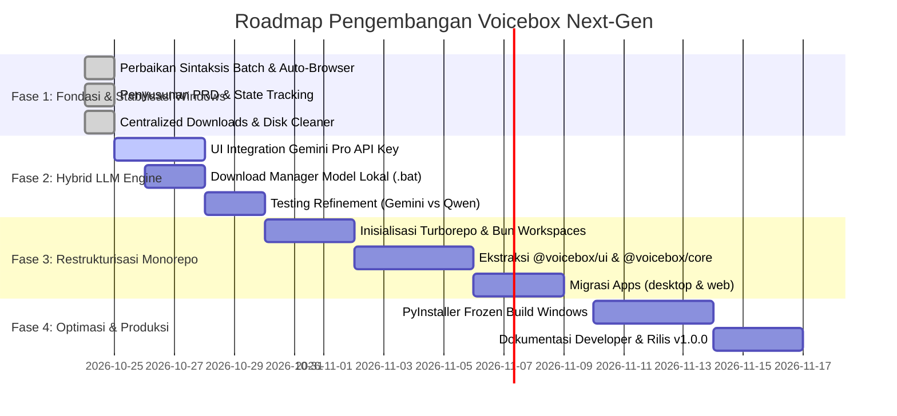

# Product Requirements Document (PRD): Voicebox Next-Gen Architecture & Hybrid AI Platform

> **Status**: APPROVED / ACTIVE ROADMAP  
> **Versi**: 1.0.0  
> **Terakhir Diperbarui**: 2026-10-24  
> **Maintainer & Lead Developer**: Ahmad Arif  
> **Lisensi**: MIT License (Turunan Teradopsi Resmi dari `jamiepine/voicebox`)  

---

## 1. Executive Summary & Visi Produk

Voicebox Next-Gen adalah platform kloning suara (Voice Cloning), Text-to-Speech (TTS), Speech-to-Text (STT), dan Diktasi AI Cerdas berlatensi rendah yang beroperasi secara hibrida: **kecepatan cloud (Google Gemini Pro) + ketahanan lokal offline (Local PyTorch / Kokoro / Qwen)**.

Tujuan utama dari perombakan arsitektur ini adalah:
1. **Rombak ke Monorepo Modern (Bun + Turborepo)**: Mengeliminasi kode rapuh (*brittle relative imports* `../../app/src/...`) dengan memisahkan aplikasi (*desktop & web*) dan paket modular (*shared UI, audio DSP, platform bridges*).
2. **Hybrid LLM Engine (UI-Managed Gemini Pro + Offline Local Fallback)**: Memindahkan konfigurasi API Key ke antarmuka pengguna (UI) tanpa edit `.env`, dengan dukungan langsung untuk Google Gemini Pro via Google AI Studio serta fallback model lokal (Qwen2.5).
3. **Higienitas Disk & Penyimpanan Terpusat**: Mengisolasi semua cache unduhan (pip wheels, PyTorch models, Hugging Face cache) ke dalam folder `downloads/` agar mudah dipantau dan dibersihkan 1-klik.
4. **Developer Experience Asli Windows**: Skrip eksekusi `.bat` yang stabil tanpa error sintaksis kurung CMD, deteksi runtime otomatis, dan peluncuran browser web otomatis.

---

## 2. Arsitektur Sistem: Transformasi Monorepo

### 2.1 Struktur Target Monorepo (Bun Workspaces + Turborepo)

```text
voiceclone/
├── apps/
│   ├── desktop/                 # Tauri v2 (Rust) Desktop App Shell
│   │   ├── src-tauri/           # Native Rust: Global Hotkeys (keytap), Audio I/O (CPAL)
│   │   └── src/                 # Desktop-specific entry point
│   ├── web/                     # Web Application Client (Vite + React 18 PWA)
│   │   └── src/                 # Browser-only entry point
│   └── docs/                    # Dokumentasi & Developer Guides (Astro / VitePress)
│
├── packages/
│   ├── ui/                      # Shared UI Design System
│   │   ├── components/          # Radix UI, Button, Dialog, Slider, Select
│   │   ├── waveform/            # WaveSurfer.js Audio Visualizer & Player
│   │   └── styles/              # Tailwind CSS v4 design tokens
│   ├── core/                    # Logika Inti & State Management
│   │   ├── stores/              # Zustand stores (audio, settings, generations)
│   │   ├── hooks/               # TanStack Query hooks & mutators
│   │   └── dsp/                 # Audio math utilities & crossfade calculations
│   ├── platform/                # Platform Abstraction Layer
│   │   ├── desktop/             # Tauri IPC bridge (clipboard paste, window focus)
│   │   └── web/                 # Web Audio API & browser storage fallback
│   └── api-client/              # OpenAPI TypeScript SDK untuk Backend FastAPI
│
├── services/
│   └── backend/                 # Python 3.12+ FastAPI Microservice
│       ├── app/                 # REST routes (/tts, /stt, /llm, /captures)
│       ├── backends/            # Engine implementations (Kokoro, F5, Gemini, Qwen)
│       ├── dsp/                 # Spotify Pedalboard audio mastering pipeline
│       └── database/            # SQLite metadata persistence & migrations
│
├── downloads/                   # Folder Terisolasi Seluruh Aset Unduhan
│   ├── models/                  # Hugging Face cache (Kokoro, Whisper, Qwen)
│   ├── pip_cache/               # Python wheel cache
│   └── torch/                   # PyTorch hub download cache
│
├── scripts/                     # Windows Batch Automation (.bat) & Maintenance
│   ├── start.bat                # Interactive Master Control Hub
│   ├── run-web.bat              # Auto-launch browser & web server
│   ├── run-desktop.bat          # Background server + Tauri desktop
│   ├── run-server.bat           # Standalone FastAPI server
│   ├── setup.bat                # Automated uv/pip/bun installer
│   ├── clean-downloads.bat      # Disk space inspector & cleaner
│   └── download-models.bat      # Script download model manual/otomatis
│
├── .agents/                     # AI Orchestration, Rules, & Skills Directory
│   ├── README.md                # Panduan Navigasi Agen
│   ├── context/session-state.md # Pelacak Status Sesi & Keputusan Terkunci
│   └── skills/                  # Katalog Skill Khusus Voicebox
│
├── turbo.json                   # Konfigurasi Turborepo Pipeline Caching
└── package.json                 # Root Workspace Manifest
```

### 2.2 Keunggulan Arsitektur Baru
- **Zero Brittle Imports**: Tidak ada lagi relative import lintas batas direktori.
- **Incremental Build Caching**: Turbo pipeline mempercepat build web dan desktop hingga 80%.
- **Separation of Concerns**: Perubahan pada komponen tombol tidak memicu build ulang pada logika Tauri Rust.

---

## 3. Fitur Utama & Spesifikasi Fungsional

### 3.1 Hybrid LLM Intelligence (Gemini Pro + Local Fallback)

#### A. UI-Managed Google Gemini Pro (Tanpa `.env`)
- **Tampilan Pengaturan Fleksibel**: Pengguna dapat memasukkan atau mengganti API Key Google AI Studio langsung dari menu **Settings -> AI Model & Diktasi** di antarmuka web maupun desktop.
- **Preset Satu Klik**: Dropdown pilihan cepat:
  1. `Google Gemini Pro (Cloud - Rekomendasi)` -> Otomatis set endpoint `https://generativelanguage.googleapis.com/v1beta/openai` dan model `gemini-1.5-pro` atau `gemini-2.0-flash`.
  2. `Qwen 2.5 Local (Offline)` -> Menggunakan model yang diunduh ke folder `downloads/models/`.
  3. `Custom Endpoint (Ollama / LocalAI)` -> Pengguna memasukkan base URL sendiri (misal: `http://localhost:11434/v1`).
- **Penyimpanan Aman di SQLite**: API Key disimpan dalam tabel `settings` lokal pada SQLite pengguna dengan enkripsi ringan (masked visual di UI dengan toggle mata hide/reveal).

#### B. Rekomendasi Model LLM Lokal & Sumber Unduhan

Untuk mode offline / privat tanpa koneksi internet, berikut adalah model yang paling kompatibel dan efisien untuk tugas Voice Refinement & Diktasi:

| Model | Ukuran VRAM / RAM | Kecepatan CPU | Kualitas Teks | Rekomendasi Penggunaan | Link Unduhan Hugging Face |
|---|---|---|---|---|---|
| **Qwen2.5-0.5B-Instruct** | ~800 MB | Sangat Cepat (Instant) | Baik | Komputer tanpa GPU / RAM 8GB | [HF: Qwen/Qwen2.5-0.5B-Instruct](https://huggingface.co/Qwen/Qwen2.5-0.5B-Instruct) |
| **Qwen2.5-1.5B-Instruct** *(Paling Cocok)* | ~2.5 GB | Cepat | Sangat Baik | **Sweet Spot**: Laptop Standar / GPU 4GB | [HF: Qwen/Qwen2.5-1.5B-Instruct](https://huggingface.co/Qwen/Qwen2.5-1.5B-Instruct) |
| **Qwen2.5-3B-Instruct** | ~5.5 GB | Sedang | Luar Biasa | Komputer dengan GPU $\ge$ 6GB VRAM | [HF: Qwen/Qwen2.5-3B-Instruct](https://huggingface.co/Qwen/Qwen2.5-3B-Instruct) |
| **Llama-3.2-1B-Instruct** | ~1.8 GB | Cepat | Sangat Baik | Alternatif Meta Llama | [HF: meta-llama/Llama-3.2-1B-Instruct](https://huggingface.co/meta-llama/Llama-3.2-1B-Instruct) |

#### C. Alur Unduhan Model Manual & Otomatis:
1. **Opsi 1 (Klik Terminal / Script)**: Jalankan `scripts/download-models.bat`, pilih nomor model, dan skrip akan mengunduh model langsung ke folder `downloads/models/`.
2. **Opsi 2 (Download Manual via Browser)**: Skrip menyediakan tautan langsung yang bisa diklik untuk membuka halaman Hugging Face di browser. File hasil unduhan cukup diletakkan di `downloads/models/<nama-model>/`.
3. **Pembaruan Model**: Saat ada versi baru (misal Qwen 3.0 atau Gemma 3), sistem menyediakan pemetaan model baru di `backend/backends/qwen_llm_backend.py` tanpa merusak data lama.

---

### 3.2 Higienitas Folder Unduhan (`downloads/`)

- Seluruh cache yang memakan ruang harddisk dialihkan ke folder `./downloads/`:
  - `HF_HOME=%CD%\downloads\models`
  - `PIP_CACHE_DIR=%CD%\downloads\pip_cache`
  - `TORCH_HOME=%CD%\downloads\torch`
- Dilengkapi alat pemeriksa ukuran disk dan pembersih aman melalui [`clean-downloads.bat`](file:///c:/Users/ASUS/Documents/Web%20Dev/improving/voiceclone/clean-downloads.bat).

---

### 3.3 Audio DSP & Voice Cloning Pipeline

- **TTS Engine**: Kokoro v1.0 (82M params, ultra-cepat 50x real-time), Chatterbox, LuxTTS, F5-TTS.
- **Audio Post-Processing**: Spotify Pedalboard (EQ, Chorus, Reverb, Compressor) untuk menghasilkan kualitas rekaman vokal profesional seperti di studio rekaman.
- **Diktasi Cerdas**: Global chord key shortcut -> Rekam suara -> Whisper STT -> Gemini Pro / Qwen Refine -> Paste teks otomatis ke aplikasi yang sedang aktif (Notepad, Word, Browser, IDE).

---

## 4. Rencana Tahapan Rilis & Milestone



---

## 5. Kriteria Penerimaan (Acceptance Criteria)

1. **Gemini Pro UI Setup**:
   - Pengguna dapat mengisi API Key Google AI Studio langsung di antarmuka tanpa perlu membuka terminal atau file `.env`.
   - Tombol "Test Connection" memverifikasi validitas API Key dan menampilkan latensi (ping).
2. **Penyimpanan Lokal Terisolasi**:
   - Partisi `C:\` sistem operasi bebas dari sampah model acak; 100% aset tersimpan di dalam folder proyek `./downloads/`.
3. **Stabilitas Skrip Windows**:
   - Seluruh file `.bat` (`start.bat`, `run-web.bat`, `setup.bat`, `run-server.bat`) bebas dari error sintaksis kurung CMD (`unexpected at this time`).
4. **Browser Auto-Launch**:
   - Memilih opsi Web otomatis membuka peramban web default ke `http://localhost:5173`.
5. **Kepatuhan Lisensi**:
   - File `LICENSE` asli MIT tetap dipertahankan dengan penambahan atribusi hak cipta pengembang turunan resmi.
